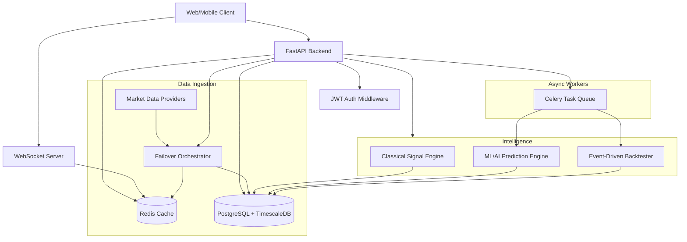

# QuantEdge Architecture

## System Diagram

## Data Flow
1. **Market Data**: Ingested via Failover Orchestrator (yfinance -> Stooq -> NSE). Cached in Redis, persisted to TimescaleDB.
2. **Signals**: Computed by TechnicalSignalEngine on demand or via batch jobs. Vectorized using pandas and cached.
3. **WebSockets**: Broadcasts live prices, signals, and backtest progress via Redis pub/sub to multiple API instances, which push to clients.
4. **Backtesting**: Runs asynchronously in Celery, sending progress via WebSocket.
