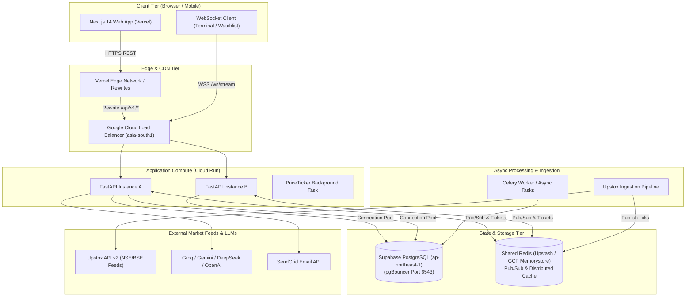

# NeuroQuant Production Architecture

## 1. System Topology Overview

---

## 2. Request & Data Ingestion Flow

### A. Live Market Data Pipeline
1. **Source**: Upstox API v2 (`https://api.upstox.com/v2/`).
   - Quotes: `GET /v2/market-quote/quotes?instrument_key=...` with standard `User-Agent: NeuroQuant/2.0`.
   - Historical / Intraday Candles: `GET /v2/historical-candle/intraday/{instrument_key}/1minute`.
2. **Caching Hierarchy**:
   - Level 1 (Local Process LRU): Quotes cached for 10 seconds; Historical bars cached for 60 seconds.
   - Level 2 (Shared Redis): Pub/Sub channel `prices.ticks` distributes live quotes across all Cloud Run instances.
   - Level 3 (PostgreSQL): Canonical DB storage in `quote_snapshots` and `ohlcv` tables.
3. **Batching**:
   - All multi-symbol UI widgets (e.g. Watchlist, Heatmap, Movers) execute a single batch REST call:
     `GET /api/v1/market/quotes?symbols=RELIANCE,TCS,INFY,HDFCBANK,M&M`
   - Zero sequential waterfall queries from client components.
4. **Canonical Persistence (`QuoteSnapshot`)**:
   - `MarketDataService.persist_quote_snapshots_batch()` continuously persists quote snapshots into `quote_snapshots` in Supabase asynchronously.
   - Populates movers, indices, heatmap, and alert evaluator without blocking real-time quote responses.
   - Computes freshness dynamically from provider timestamps without hardcoded strings.

### B. WebSocket Streaming & Fan-Out
1. **URL Resolution & Absolute Origins**:
   - `getWsBaseUrl()` in `runtime-config.ts` guarantees absolute `wss://` URLs in production browsers.
   - Prevents empty or relative WebSocket URL fallbacks which fail on Vercel edge rewrites.
2. **Handshake & Authentication**:
   - Stateless HMAC-SHA256 signed tickets (`/api/v1/auth/ws-ticket`) verified without cross-instance database locks.
   - Anonymous read-only clients permitted to subscribe to public market quote channels with explicit `channel: "prices"`.
3. **Event Channels**:
   - `prices.ticks`: Real-time LTP, bid, ask, and change percentage.
   - `signals:live`: ML prediction signals throttled to maximum 1 update per 2 seconds per symbol.
   - `order:updates`: Real-time paper trading order execution notifications.

### C. ML Inference & Quantitative Engine
1. **Lightweight Online Forecasting**:
   - On-demand price forecast uses Holt-Winters `ExponentialSmoothing` execution in ~5ms.
   - Replaced heavy statsmodels SARIMAX fitting on interactive HTTP paths.
2. **Decoupled LLM Narrative Synthesis**:
   - Groq / Gemini LLM reasoning runs asynchronously with strict 5-second timeouts.
   - Primary market signals and quantitative scores render instantly without waiting for LLM prose completion.

---

## 3. Production Invariants & SLOs

1. **Availability**: Target 99.9% uptime on `GET /health` and core market endpoints.
2. **Latency Budget**:
   - `GET /health`: p99 < 50ms.
   - `GET /api/v1/market/quotes` (cached batch): p95 < 150ms.
   - `GET /api/v1/market/history`: p95 < 350ms.
   - `GET /api/v1/market/prediction`: p95 < 500ms.
3. **Trading Safety Invariant**:
   - `LIVE_ORDER_EXECUTION_ENABLED=false` is non-negotiable.
   - Automated paper trading rejects any quote older than `AUTOTRADE_MAX_QUOTE_AGE_SECONDS` (120s).
   - Order execution occurs only in simulated ledger tables (`paper_orders`, `paper_positions`).
4. **Data Freshness Invariant**:
   - Quotes returned to the UI always specify `timestamp`, `source`, and `is_stale` flag.
   - No mock or synthetic prices are generated in production environments.
